# Hotel Demand Forecasting and Revenue Optimization (90-Day Horizon)

An end-to-end hospitality demand forecasting system predicting daily stayed arrivals across a **City Hotel** and a **Resort Hotel** (119,390 total reservations; 75,166 honored stays across 793 days from 1 July 2015 to 31 August 2017). Built to solve a core operational problem in hotel revenue management: separating true guest arrivals from heavy monthly cancellation rates (21% to 45%) so managers can set accurate staffing rosters, dynamic rate calendars, and overbooking buffers for Autumn 2017 (1 September to 29 November 2017).

---

## Executive Deliverables and Repository Files

Click any link below to explore the interactive reports, forecast outputs, or source code:

* **[Interactive Demand Forecasting Report (PDF)](Hotel_Demand_and_Forecasting_Interactive_Report.pdf)** - 23-slide interactive executive report covering model selection, rolling-origin validation, 90-day forecasts, and operational playbooks.
* **[Interactive Demand Forecasting Report (PowerPoint)](Hotel_Demand_and_Forecasting_Interactive_Report.pptx)** - Editable presentation deck for revenue strategy and ownership meetings.
* **[90-Day Autumn 2017 Forecast Output (CSV)](Hotel_Demand_Forecast_Sep_Nov_2017.csv)** - Daily stayed-arrival predictions with 80% and 95% confidence intervals by property.
* **[Rolling-Origin Validation Metrics (CSV)](Hotel_Demand_Validation_Metrics.csv)** - Complete model accuracy and bias scorecard across all four validation folds.
* **[Jupyter Analytical Notebook](Hotel_Revenue_Demand_and_Forecasting.ipynb)** | **[Production Python Script](hotel_demand_forecasting.py)** - Reproducible data pipeline, time-series decomposition, model benchmarking, and chart generation.
* **[Hotel Bookings Dataset (CSV)](hotel_bookings%20demand.csv)** - Historical reservation dataset (119,390 bookings, 32 columns).

---

## Headline Forecast Scorecard

| Metric | Portfolio Result | Operational Meaning for Hotel Leaders |
| :--- | :---: | :--- |
| **Daily Holdout Error (WAPE)** | **16.1%** | Beats the best simple baseline (18.2%) by 11.8% and naive last-week rules (28.1%) by 43% |
| **Weekly Holdout Error (WAPE)** | **8.8%** | Weekly arrival totals are highly reliable for housekeeping and front-desk shift scheduling |
| **90-Day Autumn 2017 Forecast** | **9,517 arrivals** | Projects 6,199 stayed arrivals at City Hotel and 3,318 at Resort Hotel (1 Sep to 29 Nov 2017) |
| **Year-over-Year Comparison** | **-2.5% vs. 2016** | City tracks within -1.1% of 2016, while Resort faces a -5.1% dip driven by October softness (-14.3%) |
| **Holdout Interval Coverage** | **93% (80% band)** | Empirical prediction intervals reliably capture daily demand volatility (99% inside the 95% band) |

---

## 1. The Business Problem: Why Gross Bookings Mislead Hotel Operations

Before fitting any forecasting model, historical demand analysis reveals three structural realities that distort naive hotel planning:

1. **Cancellation Distortion:** Between **21% and 45%** of monthly bookings cancel (37.0% overall; 41.7% at City Hotel and 27.8% at Resort Hotel). Planning housekeeping or food-and-beverage prep on gross bookings inflates labor budgets for guests who never arrive. Forecasting **stayed arrivals** (`is_canceled = 0`) aligns operations with true physical check-ins.
2. **Distinct Property Rhythms:** City Hotel averages **58.3 stayed arrivals/day** (spiking up to 204 arrivals on peak group days), while Resort Hotel averages **36.5 stayed arrivals/day** (spiking up to 116).
3. **Opposite Weekly Arrival Clocks:** City Hotel peaks on **Fridays (69/day)** and **Mondays (64/day)** and dips on **Tuesdays (50/day)**, whereas Resort Hotel peaks on **Mondays (42/day)**, **Saturdays (42/day)**, and **Thursdays (41/day)** and slows on **Sundays (31/day)**.

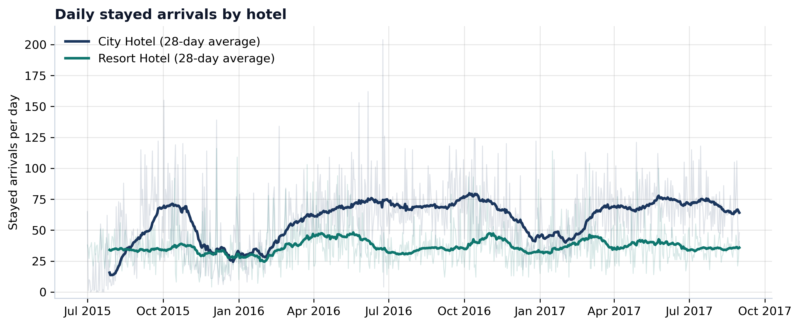

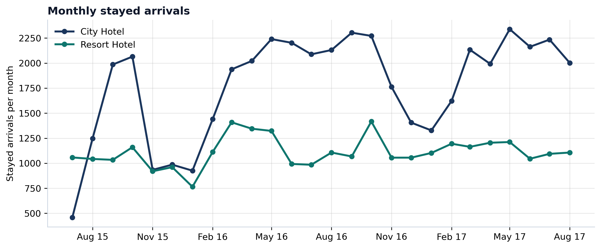

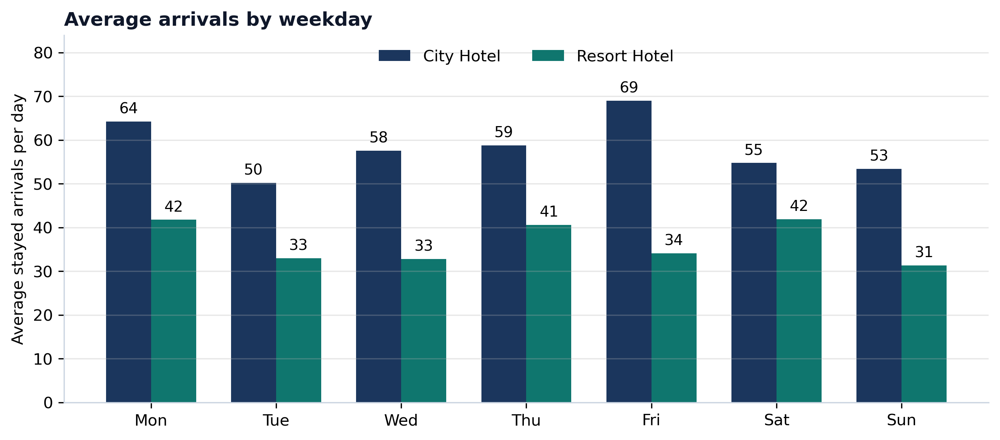


### Trend, Seasonality, and Unexplained Spikes
Decomposing the series via STL and Prophet confirms a multi-year upward trend (rising from roughly 50 arrivals/day in winter 2016 to 95 to 120 arrivals/day in spring and summer 2017), a highly repeatable 7-day cycle, and sharp positive residuals caused by single-day group blocks.

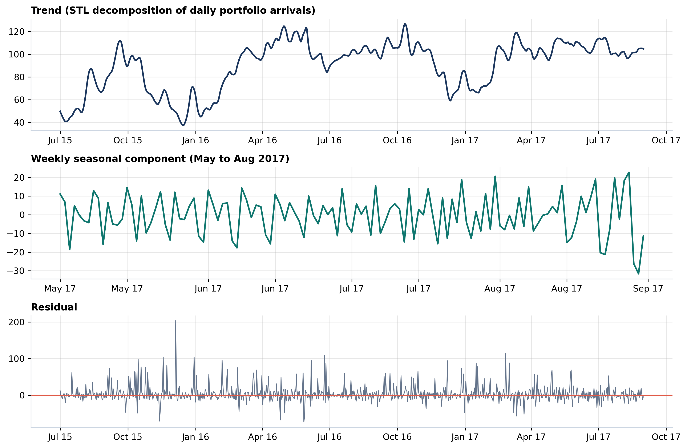

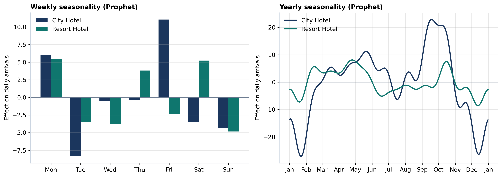

---

## 2. Forecasting Architecture and Rolling-Origin Validation

To mirror real-world revenue management, seven forecasting methods were benchmarked across **four 90-day rolling-origin validation folds**, keeping Fold 4 (**1 June to 31 August 2017**, 92 days) as an untouched summer holdout. Based on Folds 1 to 3 alone, the top three performers (**Prophet**, **Gradient Boosting**, and **ETS Holt-Winters**) were combined into an equal-weighted **Top-3 Ensemble**.

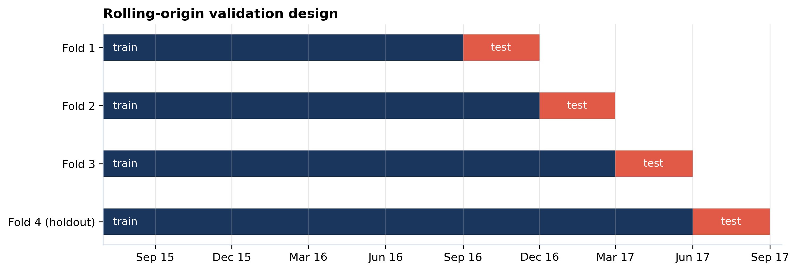

| Model | Holdout WAPE (Fold 4) | Holdout MAE (Arrivals/Day) | Holdout Bias (Actual - Forecast) | 4-Fold Average WAPE |
| :--- | :---: | :---: | :---: | :---: |
| **Ensemble (Top 3: ETS + GB + Prophet)** | **16.1%** | **16.9** | -4.5 | **19.9%** |
| **Prophet** | 16.4% | 17.2 | +3.3 | 22.4% |
| **Gradient Boosting (Calendar Features)** | 16.7% | 17.5 | -5.4 | 20.0% |
| **ETS (Holt-Winters, Additive)** | 17.8% | 18.7 | -11.5 | 21.1% |
| **Weekday Mean (Last 4 Weeks)** | 18.2% | 19.1 | -10.0 | 22.5% |
| **Seasonal Naive (364 Days)** | 19.8% | 20.7 | +1.2 | 28.9% |
| **Seasonal Naive (7 Days)** | 28.1% | 29.4 | -10.1 | 27.9% |
| **SARIMAX + Fourier** | 28.4% | 29.7 | -21.1 | 26.8% |

**Key Modeling Lesson:** Complexity alone does not guarantee accuracy. SARIMAX + Fourier (28.4% WAPE) and 7-day naive repetition (28.1% WAPE) underperformed simple 4-week weekday averages (18.2%), while combining three complementary methods (Prophet, Gradient Boosting, and ETS) delivered the lowest error on both the holdout (16.1%) and the 4-fold average (19.9%).

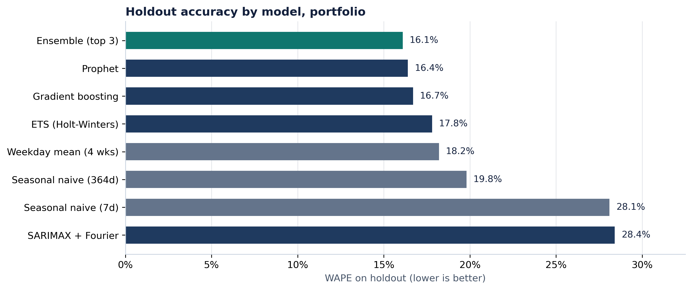

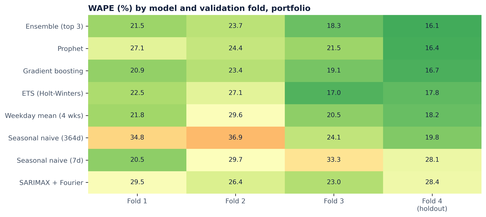

---

## 3. Holdout Performance and Error Diagnostics (June to August 2017)

On the untouched summer holdout, the Top-3 Ensemble achieved **16.1% daily WAPE** across the portfolio (**20.6%** at City Hotel; **18.6%** at Resort Hotel, beating Resort's 25.3% baseline by more than 6.7 percentage points).

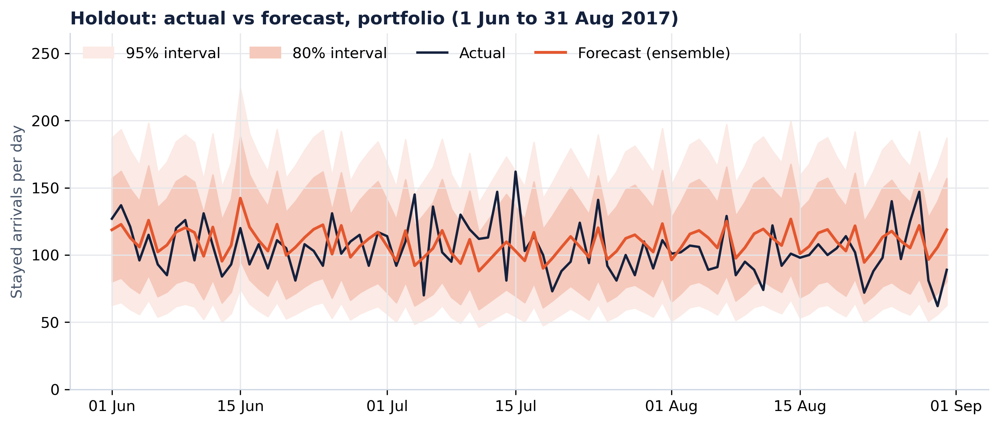

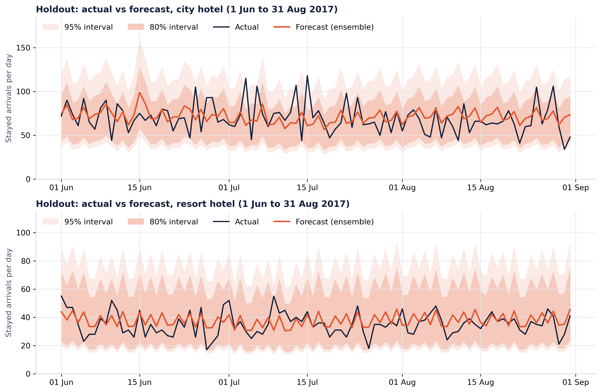

### Why Weekly Aggregation Sharpens Operational Decisions
While single-day arrivals carry 16.1% error due to unannounced group check-ins and last-minute cancellations, **weekly arrival totals cut error nearly in half to 8.8%** (and 28-day monthly totals drop to roughly 5% error). For a week forecast at 800 arrivals, actual check-ins reliably land between 730 and 870. Error diagnostics also reveal a modest +4.3% over-forecast bias (+4.5 arrivals/day), concentrated on Wednesdays (-14 bias) and Fridays (-13 bias), giving revenue managers an exact calibration adjustment.


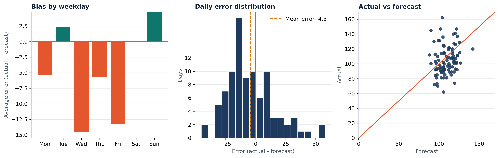

---

## 4. 90-Day Autumn 2017 Forecast (1 September to 29 November 2017)

Running the ensemble forward from 31 August 2017 projects **9,517 stayed arrivals** across the 90-day autumn window, representing a **-2.5% variance** against the same weekdays in 2016 (9,766 arrivals).

| Period | City Hotel Forecast | City vs. 2016 | Resort Hotel Forecast | Resort vs. 2016 | Portfolio Forecast | Portfolio vs. 2016 |
| :--- | :---: | :---: | :---: | :---: | :---: | :---: |
| **September 2017** | 2,231 | -2.1% | 1,076 | +3.0% | **3,306** | -0.5% |
| **October 2017** | 2,228 | -2.3% | 1,224 | -14.3% | **3,452** | -6.9% |
| **November 2017 (1 to 29)** | 1,740 | +1.8% | 1,019 | -0.6% | **2,759** | +0.9% |
| **Total 90-Day Horizon** | **6,199** | **-1.1%** | **3,318** | **-5.1%** | **9,517** | **-2.5%** |

* **Peak Arrival Windows:** Mondays (**118 arrivals/day**) and Fridays (**113 arrivals/day**) drive peak check-in congestion, led by **Monday 09 October** (132 forecast arrivals; 80% interval: 95 to 170), **Monday 18 September** (131), and **Monday 16 October** (129).
* **Trough Windows:** Demand softens sharply in late November, bottoming out on **Tuesday 28 November** (77 arrivals), **Sunday 26 November** (80), and **Wednesday 29 November** (82).


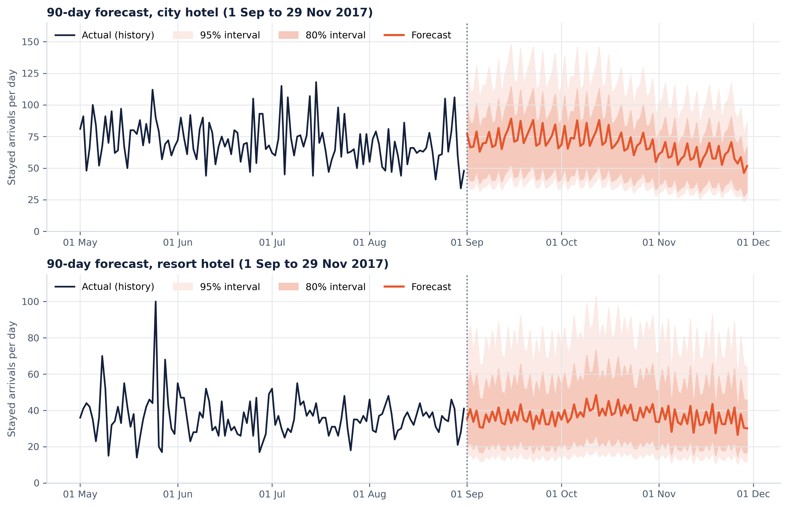

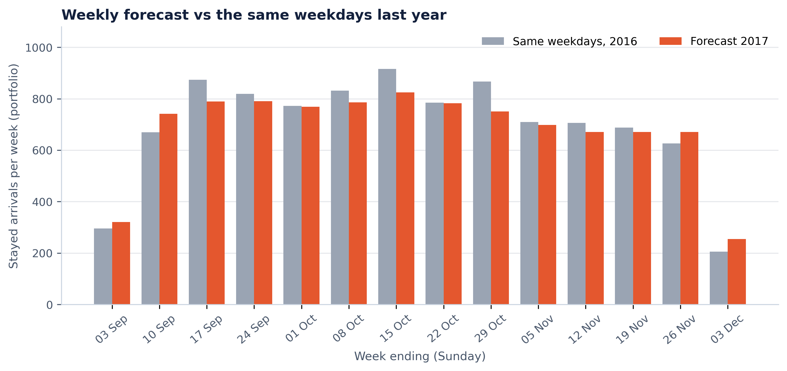

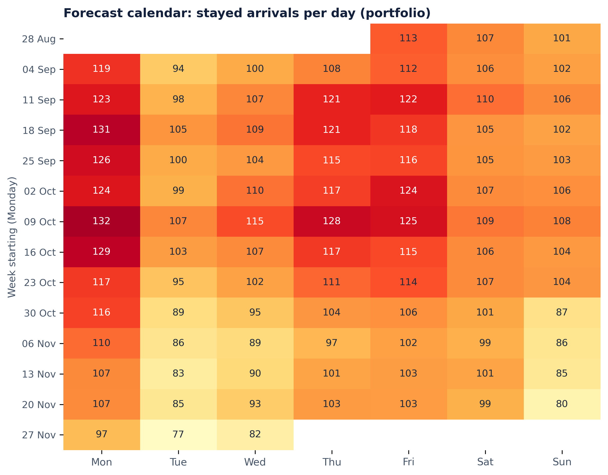

### Model Spread and Forecast Risk
Across the three ensemble members, 90-day totals span **5,735 to 6,798** for City Hotel and **3,167 to 3,416** for Resort Hotel. Notably, Resort Hotel's projected -14.3% October drop reflects a single unusually large October 2016 spike in historical training data rather than guaranteed structural decline, flagging October Resort pace as a key upside opportunity to monitor.


---

## How Hotel Managers Should Apply This Forecast to Drive All-Round Growth

A forecast only creates value when tied to commercial and operational decisions. Hotel General Managers, Revenue Managers, and Department Heads should deploy these outputs across five core workflows:

### 1. Dynamic Pricing and Yield Restrictions (Revenue Management)
* **Protect Peak Monday and Friday Rates:** On high-compression dates exceeding 125 arrivals (such as 18 September, 09 October, and 16 October), close out discounted OTA promotions, raise BAR (Best Available Rate) floors, and apply 2-night minimum length-of-stay (MLOS) restrictions to capture high-yield transient demand.
* **Stimulate Late-November Softness:** For trough weeks after 06 November (where daily arrivals drop to 77 to 89), launch targeted corporate, local staycation, and value-added dining packages 30 to 45 days in advance rather than resorting to last-minute rate slashing.
* **Audit Resort October Pace:** Because the model flags a -14.3% October variance at Resort Hotel due to 2016 group comparisons, sales and revenue teams should review on-the-books group pace immediately and deploy targeted tour-operator promotions if actual October pickup lags 2016.

### 2. Precision Labor and Housekeeping Scheduling (Operations)
* **Schedule Shifts on Weekly Totals (8.8% WAPE):** Use the weekly arrival forecast to set core housekeeping, front-desk, and laundry rosters two weeks in advance, flexing part-time or on-call staff around Monday and Friday arrival peaks and Tuesday/Sunday troughs.
* **Calibrate Wednesday and Friday Buffers:** Because holdout diagnostics show the ensemble slightly over-forecasts Wednesdays (-14 bias) and Fridays (-13 bias), operations managers can trim excess Friday afternoon front-desk overtime unless confirmed group blocks are on the books.

### 3. Net-Yield Overbooking and Cancellation Control (Distribution)
* **Pair Stayed Forecasts with Channel Cancellation Rates:** Because historical cancellations average 41.7% at City Hotel and 27.8% at Resort Hotel, revenue managers should compare gross on-the-books reservations against the ensemble's stayed-arrival forecast to set controlled overbooking buffers on peak nights without risking costly guest walks.

### 4. Continuous Commercial Monitoring Routine
* **Daily (Next 14 Days):** Compare actual on-the-books check-ins against the daily ensemble forecast; if three consecutive days breach the upper 80% confidence band, tighten rate fences immediately.
* **Weekly (Next 60 Days):** Review weekly roll-ups across Revenue, Front Office, and Sales meetings and manually layer in newly signed group blocks or local citywide events (which sit outside calendar-only features).
* **Monthly:** Re-score WAPE and directional bias at month-end and refit the ensemble with the latest actuals to prevent seasonal drift.

---

## Repository Structure

```text
├── hotel_bookings demand.csv                                  # Historical dataset (119,390 bookings, Jul 2015 to Aug 2017)
├── Hotel_Revenue_Demand_and_Forecasting.ipynb                 # Interactive Jupyter Notebook with full analysis
├── hotel_demand_forecasting.py                                # Clean standalone Python forecasting pipeline
├── Hotel_Demand_Forecast_Sep_Nov_2017.csv                     # 90-day daily forecast table with 80% & 95% intervals
├── Hotel_Demand_Validation_Metrics.csv                        # Model accuracy (WAPE, MAE, Bias) across 4 validation folds
├── Hotel_Demand_and_Forecasting_Interactive_Report.pdf        # 23-slide interactive visual report (PDF)
├── Hotel_Demand_and_Forecasting_Interactive_Report.pptx       # Editable PowerPoint presentation deck
└── images/                                                    # 18 high-resolution charts (Chart_01 to Chart_18)
