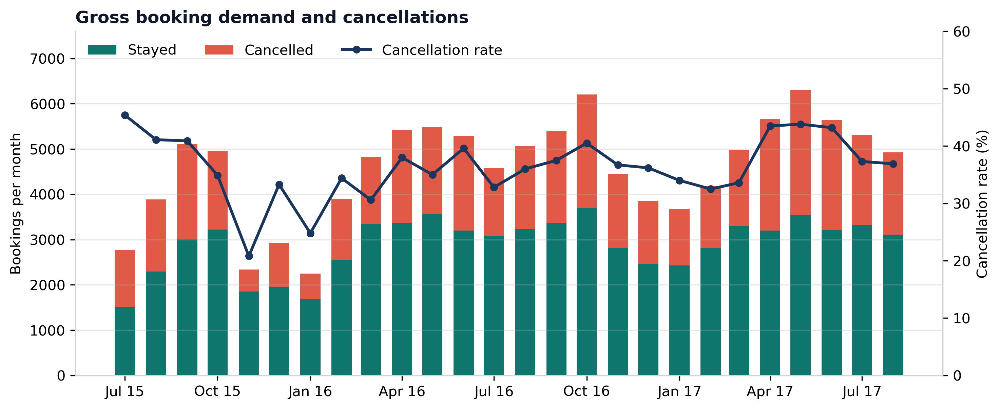
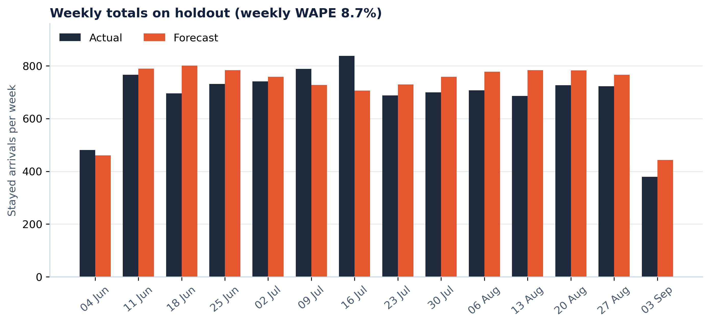
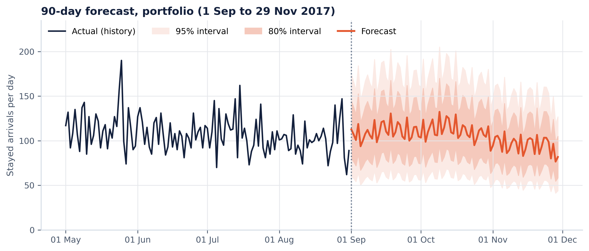
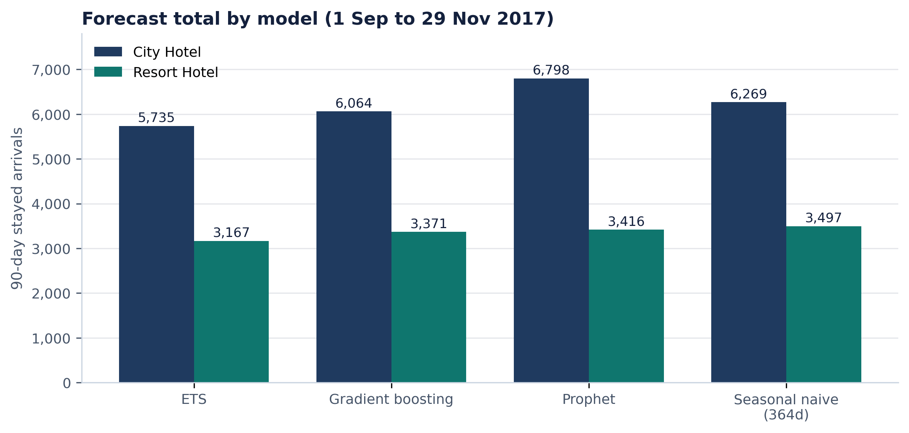

# Hotel Revenue and Demand Forecasting

Daily stayed-arrival forecasting pipeline for a City Hotel and a Resort Hotel using the Hotel Booking Demand dataset (119,390 bookings from July 2015 to August 2017). Seven forecasting methods and an equal-weighted ensemble are evaluated across four rolling-origin validation windows (~90 days each) to produce an operational 90-day forecast (1 September to 29 November 2017) with empirical 80% and 95% prediction intervals.

---

## Executive Deliverables

* **[Hotel Demand Forecasting Report (PDF)](Hotel_Demand_Forecasting_Report.pdf)** - Full 19-page report covering methodology, validation results, error diagnostics, and operational recommendations.
* **[Hotel Demand and Forecasting Interactive Report (PDF)](Hotel%20Demand%20and%20Forecasting%20Interactive%20Report.pdf)** - Interactive narrative report and analytical walkthrough.
* **[Hotel Demand and Forecasting Dashboard (PDF)](Hotel%20Demand%20and%20Forecasting%20Dashboard.pdf)** - Executive visual dashboard summarizing holdout accuracy and autumn 2017 projections.
* **[Analytical Notebook](Hotel_Revenue_Demand_and_Forecasting.ipynb)** - Complete reproducible Python workflow, statistical checks, and visualizations.

---

## Executive Summary

* **Daily Accuracy:** On the untouched 92-day summer holdout (1 June to 31 August 2017), the top-3 ensemble (ETS, Gradient Boosting, and Prophet) achieves **16.1% WAPE** and **16.9 arrivals/day MAE** across the portfolio (**20.6% WAPE** at City Hotel; **18.6% WAPE** at Resort Hotel).
* **Outperforms Simple Baselines:** Reduces daily forecast error by **11.8%** compared to the best simple benchmark (4-week weekday average at 18.2% WAPE) and by **43%** compared to repeating the prior week (28.1% WAPE).
* **Planning Horizon Aggregation:** Error drops to **8.8% WAPE** on weekly totals on the holdout and **~5% WAPE** on 28-day totals across all validation windows, providing a reliable baseline for staffing rosters and rate calendars.
* **90-Day Forecast (1 Sep to 29 Nov 2017):** Projects **9,517 stayed arrivals** (**6,199** City Hotel; **3,318** Resort Hotel), down **2.5%** versus the same weekdays in 2016 (9,766), driven primarily by a softer October (-6.9% YoY).
* **Bias and Risk Bounds:** The ensemble over-forecast the summer holdout by 4.3% (109.4 forecast vs. 104.8 actual arrivals/day). Empirical relative-residual intervals achieved **93% coverage** at the nominal 80% level and **99% coverage** at the nominal 95% level.

---

## 1. Historical Demand and Cancellation Dynamics

Realized demand is defined as non-cancelled bookings (`is_canceled = 0`) counted on arrival date (75,166 stayed vs. 44,224 cancelled bookings across 793 days). City Hotel averages 58.3 stayed arrivals/day with spring and autumn peaks, while Resort Hotel averages 36.5 stayed arrivals/day with steadier volume. Monthly cancellation rates range between **21% and 45%**, meaning gross bookings substantially overstate actual guest arrivals.




---

## 2. Seasonality Structure

Prophet additive seasonality components highlight distinct weekly and yearly patterns across the two properties. City Hotel experiences sharp Friday arrival surges (+11.0 arrivals/day) and Tuesday troughs (-8.4 arrivals/day), while Resort Hotel peaks on Mondays, Thursdays, and Saturdays.


---

## 3. Rolling-Origin Validation and Holdout Performance

Models were refitted across four expanding-window folds (~90 days per test window). Ensemble members (ETS, Gradient Boosting, and Prophet) were selected solely on Folds 1 to 3, leaving Fold 4 (1 June to 31 August 2017) as a strict holdout.


| Model | Holdout WAPE | Holdout MAE | Holdout Bias | 4-Fold Avg WAPE |
| :--- | :---: | :---: | :---: | :---: |
| **Ensemble (top 3)** | **16.1%** | **16.9** | **-4.5** | **19.9%** |
| Prophet | 16.4% | 17.2 | +3.3 | 22.4% |
| Gradient boosting | 16.7% | 17.5 | -5.4 | 20.0% |
| ETS (Holt-Winters) | 17.8% | 18.7 | -11.5 | 21.1% |
| Weekday mean (4 wks) | 18.2% | 19.1 | -10.0 | 22.5% |
| Seasonal naive (364d) | 19.8% | 20.7 | +1.2 | 28.9% |
| Seasonal naive (7d) | 28.1% | 29.4 | -10.1 | 27.9% |
| SARIMAX + Fourier | 28.4% | 29.7 | -21.1 | 26.8% |


While daily counts contain unscheduled group-booking spikes, aggregating to weekly totals smooths daily noise and reduces holdout error to **8.8% WAPE**, making the forecast directly actionable for weekly housekeeping and front-desk scheduling.



---

## 4. 90-Day Forecast Outlook (1 Sep to 29 Nov 2017)

Refitting the ensemble on all historical data up to 31 August 2017 produces daily, weekly, and monthly arrival projections by property. Within the week, portfolio demand peaks on **Mondays (118 arrivals/day)** and **Fridays (113 arrivals/day)** and dips on **Tuesdays (94)** and **Sundays (98)**, with the single busiest forecast day falling on **Monday 09 October (132 arrivals; 80% interval 95 to 170)**.

| Period | City Hotel | Resort Hotel | Portfolio | Same Weekdays 2016 | Change |
| :--- | :---: | :---: | :---: | :---: | :---: |
| September 2017 | 2,231 | 1,076 | 3,306 | 3,322 | -0.5% |
| October 2017 | 2,228 | 1,224 | 3,452 | 3,709 | -6.9% |
| November 2017 (1 to 29) | 1,740 | 1,019 | 2,759 | 2,735 | +0.9% |
| **Total (90 days)** | **6,199** | **3,318** | **9,517** | **9,766** | **-2.5%** |




Comparing the 90-day totals across individual models highlights forecast uncertainty: City Hotel projections span from 5,735 (ETS) to 6,798 (Prophet), while Resort Hotel spans from 3,167 to 3,416, with the ensemble positioned cleanly within that range.



---

## Repository Structure

```text
├── hotel_bookings demand.csv                           # Source dataset (119,390 bookings, Jul 2015 to Aug 2017)
├── hotel_demand_forecasting.py                         # Standalone batch pipeline (validation + 90-day forecast)
├── Hotel_Revenue_Demand_and_Forecasting.ipynb          # Reproducible analytical notebook and diagnostics
├── Hotel_Demand_Validation_Metrics.csv                 # Rolling-origin CV metrics across 4 folds and 8 models
├── Hotel_Demand_Forecast_Sep_Nov_2017.csv              # 90-day daily forecasts with 80% and 95% intervals
├── Hotel_Demand_Forecasting_Report.pdf                 # Full 19-page technical and operational report
├── Hotel Demand and Forecasting Interactive Report.pdf # Interactive narrative report
├── Hotel Demand and Forecasting Dashboard.pdf          # Executive summary dashboard
└── images/                                             # High-resolution PNG charts embedded in README
